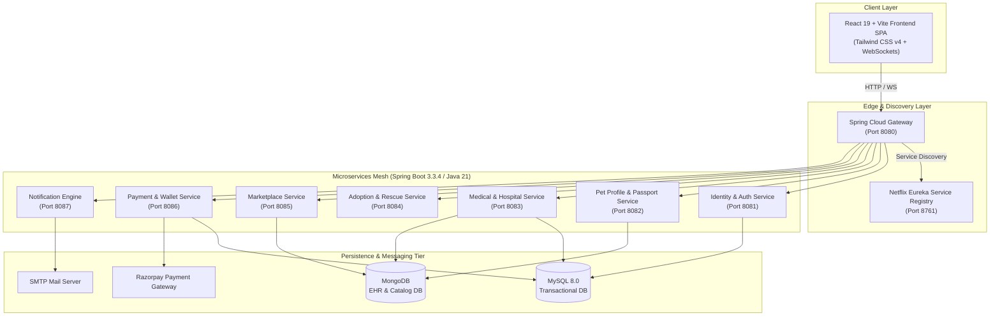

<div align="center">

# Jiva Thunai (ஜீவ துணை)
### *Next-Generation Intelligent Pet Care & Veterinary Ecosystem*

[](https://www.oracle.com/java/)
[](https://spring.io/projects/spring-boot)
[](https://spring.io/projects/spring-cloud)
[](https://react.dev/)
[](https://vitejs.dev/)
[](https://tailwindcss.com/)
[](https://www.mysql.com/)
[](https://www.mongodb.com/)
[](https://maven.apache.org/)

<p align="center">
  <b>A unified, resilient microservices platform bridging pet parents, licensed veterinary clinics, certified rescue shelters, and verified pet supply vendors.</b>
</p>

[Overview](#overview) •
[Core Capabilities](#core-capabilities) •
[System Architecture](#system-architecture) •
[Microservices Ecosystem](#microservices-ecosystem) •
[Tech Stack](#tech-stack) •
[Quick Start & Local Setup](#quick-start--local-setup) •
[Security & Compliance](#security--compliance)

</div>

---

## Overview


**Jiva Thunai** (*Life Companion*) is an enterprise-scale digital pet health, welfare, and commerce ecosystem built specifically to solve fragmentation in modern animal healthcare. By blending high-throughput Spring Boot microservices with a responsive React 19 interface, the platform offers cryptographic pet identification, live veterinary OPD triage, digital prescription compliance, ethical adoption protocols, and integrated marketplace logistics.

---

## Core Capabilities


### 1. Digital Pet Passport & Cryptographic QR

- **Tamper-Evident Identity:** Unique microchip and vaccination identity records stored in MongoDB with cryptographic QR verification.
- **Lost & Found Emergency Beacon:** Instant scan-to-notify mechanism alerting owners with geo-coordinates when a missing pet's QR tag is scanned.
- **Dynamic Privacy Controls:** Pet owners can configure contact and medical disclosure levels visible upon public QR scanning.

### 2. Veterinary Hospital Operations & Live OPD

- **Real-Time Appointment Queues:** STOMP/WebSocket-driven queue tracker for walk-ins, scheduled consultations, and emergencies.
- **Triage & Multi-Branch Management:** Dedicated dashboards for hospital administrators, chief veterinarians, and triage staff.
- **Electronic Health Records (EHR):** Comprehensive vaccination timelines, chronic allergy logs, diagnostic attachments, and surgery history.

### 3. Secure Digital Prescriptions & Care Continuity

- **Protected PDF Viewer:** In-browser prescription renderer preventing unauthorized download or prescription tampering.
- **Dosage Reminders:** Automated notification scheduler reminding owners of daily treatments and booster schedules.
- **Inter-Hospital Care Continuity:** Transfer pet medical history securely across accredited partner clinics.

### 4. Ethical Pet Adoption & Welfare Rescue Network

- **Verified Shelter Onboarding:** Mandatory KYC checks for NGOs and foster homes to eliminate illegal breeding operations.
- **Adoption Matchmaking:** Questionnaires and lifestyle compatibility scoring for prospective adopters.
- **Follow-Up Care Milestones:** Post-adoption welfare check-ins and legal compliance workflows.

### 5. Verified Pet Marketplace & Diet Store

- **Categorized Catalog:** Veterinary-approved food, supplements, prescription diets, and pet lifestyle accessories.
- **Multi-Vendor Management:** Inventory management, order tracking, returns, and merchant analytics.
- **Integrated Checkout:** Fully integrated with Razorpay for UPI, Net Banking, Cards, and Digital Wallet transactions.

---

## System Architecture




---

## Microservices Ecosystem


| Service | Port | Description | Database / Integrations |
| :--- | :---: | :--- | :--- |
| **`service-registry`** | `8761` | Eureka Server for dynamic service discovery and heartbeat checks. | In-Memory Registry |
| **`api-gateway`** | `8080` | Unified reverse proxy, rate-limiting, CORS, and routing. | Spring Cloud Gateway |
| **`common`** | — | Shared DTOs, cross-cutting security filters, exceptions, and utilities. | Maven Shared Library |
| **`identity-service`** | `8081` | Authentication, RBAC, KYC approvals, JWT generation & validation. | MySQL (`PetCareJT`) |
| **`pet-profile-service`** | `8082` | Digital pet profiles, cryptographic QR tag generation, lost-pet reports. | MongoDB (`PetCareJT`) |
| **`medical-health-service`** | `8083` | Hospital operations, doctor rosters, appointments, live OPD queue, EHR. | MySQL + MongoDB |
| **`adoption-service`** | `8084` | Shelter management, adoption listings, applicant background screening. | MySQL |
| **`marketplace-service`** | `8085` | E-commerce catalog, cart management, category listings, reviews. | MongoDB (`jivathunai_marketplace`) |
| **`payment-wallet-service`** | `8086` | Razorpay order orchestration, webhook signatures, refund management. | MySQL + Razorpay API |
| **`notification-engine`** | `8087` | Email alerts, appointment reminders, broadcast notifications. | JavaMail / SMTP |

---

## Tech Stack


### Frontend
- **Core Framework:** [React 19](https://react.dev/), [Vite 8](https://vitejs.dev/)
- **Routing & State:** [React Router v7](https://reactrouter.com/), Context API
- **Styling:** [Tailwind CSS v4](https://tailwindcss.com/), PostCSS
- **Iconography:** [Lucide React](https://lucide.dev/)
- **Real-Time & Media:** [STOMP.js](https://github.com/stomp-js/stompjs) / [SockJS](https://github.com/sockjs/sockjs-client), [PDF.js](https://mozilla.github.io/pdf.js/), [React Easy Crop](https://github.com/ValentinH/react-easy-crop)
- **Linter:** [Oxlint](https://oxc.rs/)

### Backend
- **Language & Runtime:** Java 21 LTS
- **Core Frameworks:** Spring Boot 3.3.4, Spring Cloud 2023.0.3, Spring Security 6
- **Token Security:** JJWT 0.12.6 (HMAC-SHA256)
- **Persistence:** Spring Data JPA (Hibernate), Spring Data MongoDB
- **Build Automation:** Apache Maven (Multi-module)

---

## Quick Start & Local Setup


### 1. Prerequisites
- **Java:** JDK 21+ installed and configured on `JAVA_HOME`
- **Node.js:** v18.x or v20+ with npm
- **Databases:**
  - MySQL Server 8.0 running on `localhost:3306`
  - MongoDB 7.0 running on `localhost:27017`

---

### 2. Configure Environment Variables
Copy the provided environment template to `.env` in the root directory:

```bash
cp .env.example .env
```

Update `.env` with your local credentials:
```properties
# MySQL
MYSQL_HOST=localhost
MYSQL_PORT=3306
MYSQL_DATABASE=PetCareJT
MYSQL_USER=root
MYSQL_PASSWORD=your_password

# MongoDB
MONGO_URI=mongodb://localhost:27017/PetCareJT
MARKETPLACE_MONGO_URI=mongodb://localhost:27017/jivathunai_marketplace

# Razorpay & Mail
RAZORPAY_API_KEY_ID=your_key_id
RAZORPAY_API_KEY_SECRET=your_key_secret
SMTP_USERNAME=your_email@domain.com
SMTP_PASSWORD=your_app_password

# Security
JWT_SECRET=YourSuperSecretKey256BitOrGreaterForHMACSHA256
```

---

### 3. Build & Run Backend Microservices

From the project root:

```bash
cd backend

# Compile and package all microservices
mvn clean package -DskipTests
```

Start the services in the following order:

1. **Service Registry (Eureka)**:
   ```bash
   cd service-registry
   mvn spring-boot:run
   ```
   *Dashboard available at: `http://localhost:8761`*

2. **API Gateway**:
   ```bash
   cd ../api-gateway
   mvn spring-boot:run
   ```

3. **Core Services** (can be launched concurrently in separate terminals):
   ```bash
   # Identity Service
   cd ../identity-service && mvn spring-boot:run

   # Pet Profile Service
   cd ../pet-profile-service && mvn spring-boot:run

   # Medical & Health Service
   cd ../medical-health-service && mvn spring-boot:run

   # Payment & Wallet Service
   cd ../payment-wallet-service && mvn spring-boot:run

   # Marketplace Service
   cd ../marketplace-service && mvn spring-boot:run

   # Adoption Service
   cd ../adoption-service && mvn spring-boot:run

   # Notification Engine
   cd ../notification-engine && mvn spring-boot:run
   ```

---

### 4. Run Frontend Application

From the project root:

```bash
cd frontend

# Install dependencies
npm install

# Start Vite dev server
npm run dev
```

*The application will launch at: `http://localhost:5173`*

---

## Security & Compliance


- **Stateless Authentication:** Strict JWT validation with configurable token expiration and cryptographically signed claims.
- **Zero Secrets in Git:** Sensitive environment files (`.env`, certificates, and keys) are strictly tracked in `.gitignore`. A sanitized `.env.example` is maintained for documentation.
- **Role-Based Access Control (RBAC):** Granular authority scopes for `PET_PARENT`, `VET_DOCTOR`, `CLINIC_ADMIN`, `SHELTER_STAFF`, and `SUPER_ADMIN`.
- **CORS Protection:** Configured through Spring Cloud Gateway with origin validation and method restrictions.

---

## Repository Structure


```text
PetCareJT/
├── .env.example                       # Environment variables template
├── .gitignore                         # Comprehensive Git exclusion rules
├── README.md                          # Project documentation
├── backend/                           # Maven Multi-Module Microservices
│   ├── pom.xml                        # Parent POM with dependency management
│   ├── common/                        # Shared models, DTOs & exception handlers
│   ├── service-registry/              # Eureka Service Discovery Server
│   ├── api-gateway/                   # Spring Cloud API Gateway
│   ├── identity-service/              # User, Auth, Role & KYC Service
│   ├── pet-profile-service/           # Pet Passport & QR Tracking Service
│   ├── medical-health-service/        # Clinic & Hospital Live Operations
│   ├── adoption-service/              # Adoption & Shelter Rescue Network
│   ├── marketplace-service/           # E-Commerce Product & Order Service
│   ├── payment-wallet-service/        # Razorpay & Wallet Transaction Engine
│   └── notification-engine/           # Email & Webhook Dispatcher
└── frontend/                          # Vite + React 19 Frontend
    ├── package.json                   # Frontend dependencies & scripts
    ├── vite.config.js                 # Vite build & plugin settings
    └── src/
        ├── components/                # Reusable UI & role-specific widgets
        ├── pages/                     # Application pages & portals
        ├── context/                   # Auth, Cart, Navigation & Notification states
        └── services/                  # Gateway API HTTP & WebSocket clients
```

---

## Contributing


Contributions make the open-source community a better place to learn, inspire, and create.

1. Fork the Project
2. Create your Feature Branch (`git checkout -b feature/AmazingFeature`)
3. Commit your Changes (`git commit -m 'Add some AmazingFeature'`)
4. Push to the Branch (`git push origin feature/AmazingFeature`)
5. Open a Pull Request

---

## License


This project is licensed under the **MIT License** - see the [LICENSE](LICENSE) file for details.

<div align="center">
  <sub>Developed for the welfare of animals and modern veterinary care by the Jiva Thunai Engineering Team.</sub>
</div>
